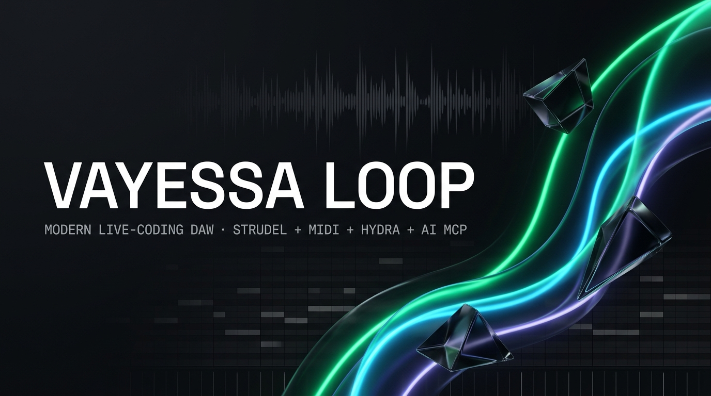
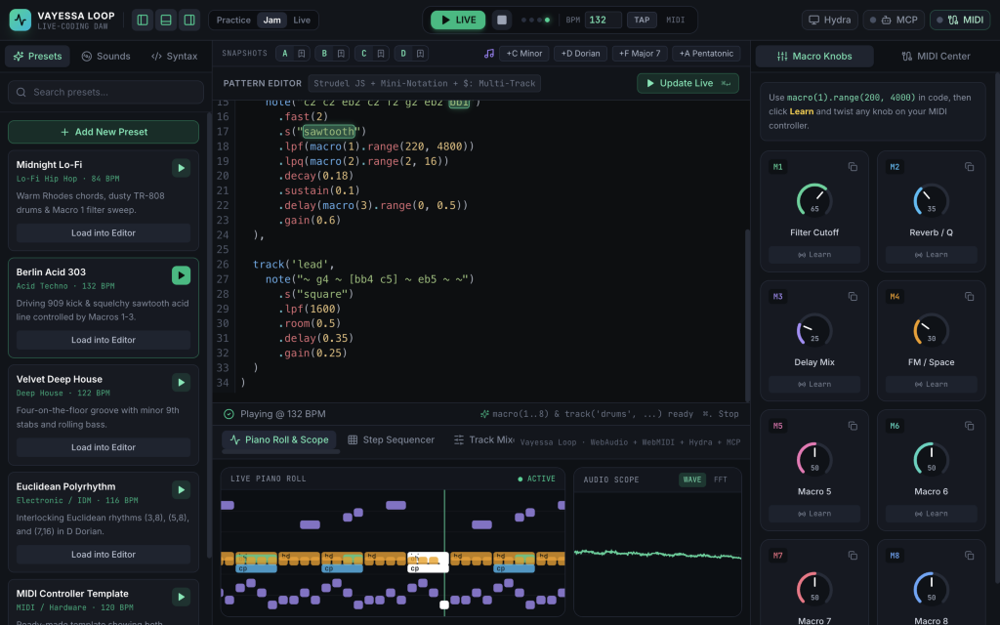

<p align="center">
  
</p>

<h1 align="center">VAYESSA LOOP</h1>

<p align="center">
  <strong>Modern DAW-Grade Live-Coding Music Studio</strong><br />
  Powered by <a href="https://codeberg.org/uzu/strudel">Strudel</a> · First-Class WebMIDI · Visual WAV/MP3 Sampler &amp; Wave Shifter · Visual Oscillator · Hydra 2nd Monitor (3D Mapping) · Universal AI MCP Control
</p>

<p align="center">
  
  
  
  
  
  
  
</p>

---

## Overview

**VAYESSA LOOP** reimagines live-coding music with a sleek dark Studio DAW interface while keeping **100% compatibility with native Strudel syntax** (`$:` multi-track labels, mini-notation, `slider()`, `midin()`, `await initHydra()`, and live active-token highlighting).

<p align="center">
  
</p>

---

## Key Features

### Live-Coding & Ease of Use
- **Real-Time Mini-Notation Highlighting**: Every active note, chord, and sample lights up at 60fps directly inside the CodeMirror 6 Pattern Editor.
- **Smart Syntax Error Popup + Safe-Eval Guard**: Floating diagnostic popup pinpoints exact **Line & Column**, highlights the broken line in red, offers 1-click **Auto-Fix**, and keeps your previous audio playing smoothly during live sets.
- **3 Dedicated Studio Modes**:
  - **Practice**: Built-in WebAudio Metronome, Slow-Down Speed (`0.5x` / `0.75x` / `1x`), and Guided Exercises.
  - **Jam**: Full DAW workspace + **A/B/C/D Pattern Snapshots** & 1-click Scale/Chord Helpers.
  - **Live Session**: Distraction-free stage view with **Live Playlist** front-and-center.
- **Custom Presets & Sound Browser**: Audition & insert TR-808, TR-909, synths, and GM Soundfonts, or save your own custom presets permanently.
- **Track Mixer & Macro Knobs**: Live `track('drums', ...)` Mute/Solo/Gain/LPF strips + 8 rotary Macro Knobs (`macro(1)`–`macro(8)`).
- **Hybrid 16-Step Sequencer**: Visual drum & synth grid that syncs cleanly into Strudel mini-notation.

### Sound Design & Sampling
- **Visual WAV/MP3 Sampler & Wave Shifter**: Import `.wav` / `.mp3` files (stored persistently in **IndexedDB**), visually trim/cut, shift waveform phase (**Wave Shift `0–100%`**), pitch-shift (`-12..+12 st`), apply **Wave Warp**, reverse, chop into **1 / 4 / 8 / 16 playable MPC slices**, and insert into Strudel in 1 click.
- **Visual Oscillator & Synth Designer**: 5 waveforms (*Sine*, *Triangle*, *Saw*, *Square*, *Supersaw*), live Waveform & ADSR Envelope visualizers, FM/Filter/LFO/FX sliders, live `oscSynth(...)` bridge, and direct MIDI Keyboard routing.

### First-Class MIDI Controller Support
- **Plug & Play WebMIDI**: Auto-detects USB MIDI keyboards, knob controllers, and pad grids.
- **1-Click MIDI Learn**: Bind physical knobs, faders, and pads to Macro Knobs, Mixer channels, BPM, or Playlist transitions.
- **Keyboard Live Play & Note Capture**: Play live and capture riffs straight into Strudel `note("...")` syntax.
- **MIDI Out & Clock Sync**: Full support for `.midi('Device')`, `.ccn()`, `.ccv()`, and `.midiclock()`.

### Live Performance Playlists & Hydra 2nd Monitor
- **Multi-Playlist Setlists with Audio Fades**: Create multiple playlists with per-track **Smooth Fade**, **Filter Sweep**, or **Instant Cut** (`0s`–`12s`) and linked Hydra visuals.
- **Hydra 2nd Monitor (`/?view=hydra`)**: Dedicated fullscreen WebGL visual window with 12 modern presets (Liquid Chrome, Anamorphic Prism Glass, Brutalist Grid, Webcam Chrome & RGB Split, and **4× 3D Projection Mapping** styles), 1-click **Modern FX** bar, **3D Tilt / Calibration Grid**, and 60fps audio FFT + MIDI Macro sync.

<p align="center">
  
</p>

### Universal AI Control (Model Context Protocol — MCP)
- Built-in **MCP Server** (`dist-mcp/mcp-server/index.js`) exposing **19 tools** and **3 resources** so **Claude, Gemini, ChatGPT/Codex, Cursor, Antigravity, or any MCP client** can compose patterns, mix tracks, sculpt the Oscillator, transition Live Playlists, and drive Hydra visuals in real time.

---

## Quick Start

### Requirements
- **Node.js 18+**
- **Chrome, Edge, Brave, or Opera** (recommended for WebMIDI & WebGL)

### Install & Run
```bash
git clone https://github.com/HafizalJohari/vayessa-loop.git
cd vayessa-loop
npm install
npm run dev
```
Open **http://localhost:5173/** in your browser and press **`Cmd + Enter`** (`Ctrl + Enter` on Windows) to play!

### Build & Test
```bash
npm run test       # Run Vitest unit test suite (25 tests)
npm run build      # TypeScript check + Vite production bundle + MCP server build
```

---

## Connecting Frontier AI Models (MCP)

Build the MCP server (`npm run build:mcp`) and add the following to your AI client's MCP configuration (Claude Desktop, Cursor, Antigravity, Windsurf, Gemini CLI, etc.):

```json
{
  "mcpServers": {
    "vayessa-loop": {
      "command": "node",
      "args": ["/absolute/path/to/vayessa-loop/dist-mcp/mcp-server/index.js"]
    }
  }
}
```

Keep **VAYESSA LOOP** open in your browser (`http://localhost:5173/`) — the **MCP** status pill in the top bar will automatically connect to `ws://127.0.0.1:5174`.

---

## Documentation

Read the full step-by-step guide in **[USER_MANUAL.md](./USER_MANUAL.md)**.

---

## License

Built on top of the open-source [Strudel](https://codeberg.org/uzu/strudel) and [Hydra](https://hydra.ojack.xyz/) ecosystems.
